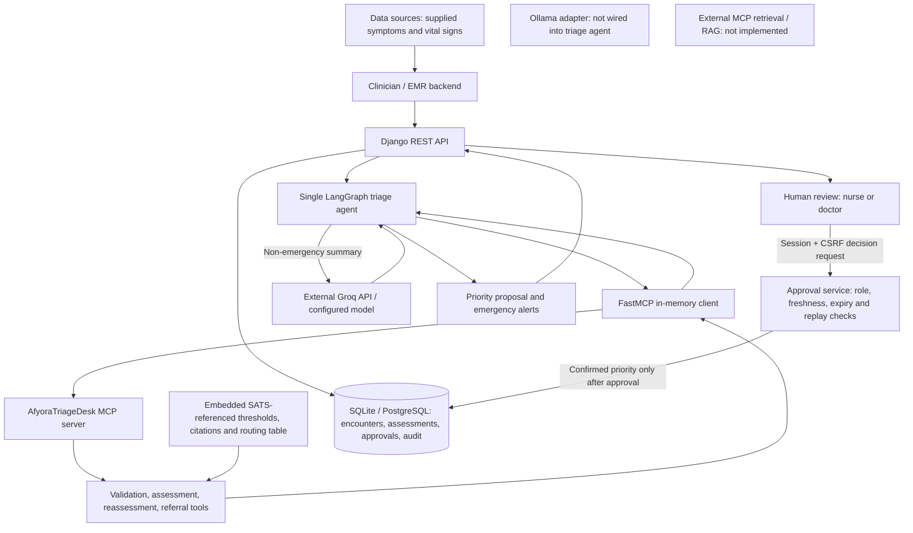

# Afyora Clinical Decision AI

## The Triage Desk

The Triage Desk is a clinical decision-support prototype that coordinates adult vital-sign screening, evidence-linked priority proposals, and explicit clinician approval. It supports clinical judgment; it is not an autonomous clinician, a diagnostic system, or a validated patient-queue manager.

## Problem statement

In busy public hospitals, the work between recording symptoms and vital signs and establishing a clinician-confirmed urgency level can become a bottleneck. Checking thresholds, identifying missing observations, documenting decisions, and reassessing changing symptoms compete for nurses' and doctors' time.

The project's motivation includes its creator's experience seeking care in Nairobi's public hospitals, including Kenyatta National Hospital (KNH). The intended use case is support for frontline triage in resource-constrained settings, not a claim that KNH uses this software or that its specific workflows have been studied. Deployment would require collaboration with local clinicians and alignment with Kenyan guidance and facility protocols.

## Solution overview

The system validates supplied observations, applies deterministic screening rules referenced to the South African Triage Scale (SATS), and proposes a priority with triggered criteria and source citations. An optional AI-generated summary accompanies non-emergency findings. Emergency findings bypass summarisation and instruct staff to act immediately, without waiting for software approval.

Missing measurements are not evidence of normality. A qualified clinician reviews each proposal before a confirmed priority is recorded. Reassessment and referral tools produce advisory outputs rather than authorising patient movement or treatment. These prototype rules require independent clinical validation; they do not implement the complete SATS assessment.

## Target users

- Nurses and doctors reviewing triage observations and confirming priorities.
- Hospital operators reviewing assessment and approval history.
- EMR/HIS backend teams integrating encounter and assessment APIs.
- Patients, as intended beneficiaries of more consistent and timely prioritisation; outcome improvements have not yet been demonstrated in clinical deployment.

## Technology stack

| Component                       | Technology                                                                       |
| ------------------------------- | -------------------------------------------------------------------------------- |
| Backend and REST APIs           | Python, Django 5.2, Django REST Framework                                        |
| Agent orchestration             | LangGraph 0.3.34, typed `StateGraph`                                             |
| MCP client/server               | FastMCP 2.14.5, embedded in-memory transport                                     |
| Input/output validation         | Pydantic v2                                                                      |
| Current triage summary provider | Groq SDK/API; configurable `GROQ_MODELS`, default `openai/gpt-oss-120b`          |
| Optional inference adapter      | Ollama HTTP API, default `llama3.2:3b`; not connected to the triage summary node |
| Database                        | SQLite by default; PostgreSQL through `DATABASE_URL` and the Render Blueprint    |
| Deployment                      | Gunicorn, WhiteNoise, Render                                                     |
| Authentication                  | Django sessions and hashed integration bearer tokens                             |

## Architecture



The diagram shows application data flow, not a deployed KNH integration. Clinical evidence is embedded configuration, not live retrieval or registered MCP resources. See [ARCHITECTURE.md](ARCHITECTURE.md) for additional design context; the implementation status and limitations below take precedence over aspirational components in that document.

## Agent architecture

One agent follows a predefined graph: `validate_vitals` -> `assess_priority` -> optional `llm_summarise` -> `propose_priority` -> `await_approval`. Conditional edges route assessment errors to an error terminal and immediate emergencies directly to the proposal, skipping the LLM. This is a bounded, tool-using workflow, not an unrestricted planner or multi-agent system.

The graph carries structured in-memory state: inputs, parsed observations, criteria, warnings, recommendations, model-summary metadata, and a workflow audit trail. There is no configured persistent LangGraph checkpointer, conversational memory, or vector database. Django persists clinical workflow records separately. MCP validation and assessment nodes have 15-second deadlines; the overall agent deadline defaults to 60 seconds. The current LLM call is synchronous, so the overall async timeout is not a hard cancellation guarantee for provider execution. Provider timeouts must also be configured. A retry constant exists, but tool retries are not implemented.

Deterministic rules control priority. The current summary node calls the existing Groq analysis service and falls back to the rule recommendation on model failure. It is not yet a dedicated triage-only summary prompt.

## MCP implementation and tools

The custom `AfyoraTriageDesk` FastMCP server exposes four tools with Pydantic input/output schemas. The LangGraph validation and assessment nodes connect using `MCPClient` and parse structured results; no MCP network listener or subprocess is started in this workflow.

| Tool                            | Purpose                                                                                | Current agent connection                     |
| ------------------------------- | -------------------------------------------------------------------------------------- | -------------------------------------------- |
| `validate_vitals`               | Parse observations and check adult eligibility without scoring                         | Called by validation node                    |
| `assess_triage_priority`        | Return a proposed priority, triggered criteria, citations and emergency recommendation | Called by assessment node                    |
| `request_clinical_reassessment` | Return reassessment information with `queue_unchanged=True`                            | Exposed tool; not called by assessment graph |
| `prepare_department_referral`   | Propose a department using an embedded facility routing table                          | Exposed tool; not called by assessment graph |

The tool functions return advisory outputs; persistent flags, approval records, and API-level audit records are responsibilities of the Django layer. The server's tool logging is not itself a database-backed audit record for every invocation. Thresholds, citations, and routing rules are embedded Python data, not registered MCP resources. No external MCP server, `mcp-server-fetch` connection, or RAG data source is currently implemented. Groq and the optional Ollama adapter use their provider APIs directly, not MCP.

The separate `/api/clinical-ai/analyze/` endpoint uses an embedded context-preparation MCP tool and the older clinical-analysis response contract described below. It is not the LangGraph triage workflow.

## Human-in-the-loop workflow

1. Register an encounter with synthetic or approved de-identified observations.
2. Run the agent to create an assessment and pending approval request. Proposed and confirmed priorities remain separate.
3. Surface emergency recommendations immediately. Clinical action must not wait for an approval click.
4. An authenticated clinician with a server-assigned `NURSE` or `DOCTOR` role approves or rejects the exact proposal.
5. Approval records the confirmed priority on the encounter; rejection does not apply a new confirmed priority. Decisions are audited. This does not directly control an external hospital queue.

The approval service checks roles, clinical-input freshness, expiry, and duplicate submissions, and uses a transaction with an approval-row lock for committing decisions. See limitations below for remaining concurrency validation needs.

## Triage usage instructions

After completing backend setup, run `python manage.py runserver` and sign in at `/accounts/login/`. Use `/sandbox/` with synthetic data to exercise the workflow. In `DEBUG=True`, opening the sandbox assigns a persisted `NURSE` role only to users with no existing role; use a separate development database. Production does not assign testing roles. Production clinical roles must be provisioned by authorised operators.

For backend integration, create an application token as described below, export it as `CLINICAL_AI_TOKEN`, and register a synthetic encounter:

```sh
curl -X POST http://127.0.0.1:8000/api/triage/encounters/ \
  -H "Authorization: Bearer $CLINICAL_AI_TOKEN" \
  -H "Content-Type: application/json" \
  -d '{"encounter_ref":"synthetic-demo","age":35,"is_pregnant":false,"symptoms":["mild headache"],"vitals":{"heart_rate":72,"respiratory_rate":16,"oxygen_saturation":98,"temperature":37.0,"blood_pressure":"120/80"}}'
```

Use the returned `encounter_id` to call `POST /api/triage/encounters/{encounter_id}/assess/` with the same bearer header. The current assessment endpoint returns HTTP `201`, including `approval_id`, `proposed_priority`, warnings, and the recommendation. Inspect `GET /api/triage/encounters/{encounter_id}/` for recorded status.

To decide, use a clinician session and CSRF token, not the application bearer token: `POST /api/triage/approvals/{approval_id}/decide/` with `{"clinical_role":"NURSE","decision":"APPROVED","comments":"Reviewed synthetic case"}`. The supplied role must match the clinician's server-assigned role. Use `REJECTED` to reject a proposal. Reassessment is available at `POST /api/triage/encounters/{encounter_id}/reassess/`; clinician audit access is available at `GET /api/triage/encounters/{encounter_id}/audit/`. See the [integration guide](docs/integration.md) for credentials and the [evaluation protocol](EVALS.md) for synthetic scenarios; API examples here reflect the current implementation.

## Limitations

- Prototype only: no clinical deployment, KNH partnership, or measured patient-outcome benefit is claimed. Adult screening is not complete SATS, NEWS2, diagnosis, or treatment guidance.
- Adult rules require known age at least 16 and exclude known pregnancy. Paediatric and obstetric pathways require separate clinical assessment. Validate all thresholds, input handling, and local protocols before use.
- Deterministic screening can run without an LLM, but the triage summary node currently calls Groq. Setting `USE_LOCAL_MODEL=true` alone does not prevent cloud calls from that node; local-only inference requires wiring and verification.
- The reused clinical-analysis prompt can generate diagnostic/advisory content. A dedicated triage-only prompt and output safeguards are needed before claiming summaries never contain diagnosis or medication advice.
- No automatic de-identification, continuous monitoring, external retrieval, autonomous queue management, or committed referral workflow is implemented. Free text must be de-identified by callers.
- Tool schemas, alias handling, missing-data handling, request limits, and tenant/object-level authorisation require further hardening. Audit permissions restrict ordinary users but do not make records tamper-proof against privileged database access.
- Approval freshness and expiry checks run before the commit lock; concurrent clinical updates require additional protection and testing. SQLite does not provide PostgreSQL-equivalent row locking.
- Self-registration lacks email verification. Production needs identity verification, abuse prevention, operational security review, and Kenyan data-protection compliance assessment. Synthetic tests are not clinical validation.

## Future improvements

- Validate the workflow with Kenyan clinicians and seek a facility-approved pilot, including KNH only through an established collaboration.
- Align screening, escalation, and referral configuration with locally approved protocols; evaluate prioritisation accuracy, staff workload, and time to clinician review.
- Connect and verify local Ollama inference, introduce a triage-only summary schema, and enforce reliable provider and workflow deadlines.
- Harden authorisation, input validation, approval concurrency, and audit integrity before multi-facility use.
- Integrate approved EMR/HIS interfaces and facility-specific referral pathways; add paediatric or obstetric support only after clinical validation.
- Implement approved external MCP reference retrieval only with source controls, privacy safeguards, and explicit provenance. Add continuous monitoring only as a separately validated workflow.

## Deploy to Render

The repository includes a Render Blueprint in `render.yaml` and a `build.sh` build script. Push these files to your Git repository, then in Render choose **New + → Blueprint**, connect the repository, and apply the Blueprint. It creates a Python web service and a persistent PostgreSQL database. The selected smallest persistent web/database plans are paid Render resources; review Render's current pricing before applying.

During Blueprint setup, enter the rotated Groq credential when prompted for `GROQ_API_KEY` and a comma-separated model pool for `GROQ_MODELS` (for example, `openai/gpt-oss-120b,openai/gpt-oss-20b`). Both are managed in the Render service's Environment settings, not hardcoded in the Blueprint. On existing services, verify these values in Render; `sync: false` variables are requested during initial Blueprint creation and are not updated by subsequent Blueprint syncs. The Blueprint generates `DJANGO_SECRET_KEY`; do not add secrets to the repository.

Render-provided environment variables take precedence over local `.env` values. `DATABASE_URL` comes from the provisioned database, `RENDER_EXTERNAL_HOSTNAME` is added to allowed hosts and trusted HTTPS origins, and Render supplies `PORT` for Gunicorn. Optional custom domains can be set with comma-separated `ALLOWED_HOSTS` and `CSRF_TRUSTED_ORIGINS` variables.

| Environment variable           | Default | Purpose                            |
| ------------------------------ | ------- | ---------------------------------- |
| `GROQ_TIMEOUT_SECONDS`         | `30`    | Provider request timeout           |
| `CLINICAL_MCP_TIMEOUT_SECONDS` | `5`     | Local context preparation deadline |
| `CLINICAL_MAX_REQUEST_BYTES`   | `65536` | Clinical request body limit        |
| `WEB_CONCURRENCY`              | `1`     | Gunicorn worker processes          |
| `GUNICORN_TIMEOUT_SECONDS`     | `90`    | Gunicorn worker timeout            |

Timeouts must be finite positive numbers and the request limit must be a positive integer; invalid Django limits fail at startup. Keep the Gunicorn timeout above the combined Groq and context preparation deadlines, with additional overhead. Increase worker count only within the service's memory budget. Gunicorn variables must be supplied through Render or exported in the launching shell; Django's `.env` loader does not configure its parent shell.

Render build command:

```sh
bash build.sh
```

Render start command:

```sh
python manage.py migrate --noinput && gunicorn afyoraAIAgent.wsgi:application --bind "0.0.0.0:$PORT" --workers "${WEB_CONCURRENCY:-1}" --timeout "${GUNICORN_TIMEOUT_SECONDS:-90}" --access-logfile -
```

The start command applies outstanding database migrations before launching Gunicorn. After the first deploy, create an administrator from the Render Shell with `python manage.py createsuperuser`. The app's self-service signup currently has no email verification; add identity verification and abuse prevention before opening it to the public.

## Backend setup

Install the declared dependencies and apply Django migrations:

```sh
python -m venv .venv
source .venv/bin/activate
python -m pip install -r requirements.txt
python manage.py migrate
python manage.py runserver
```

Copy `.env.example` to `.env` and set `GROQ_API_KEY` to a key obtained from the Groq Console. `.env` is ignored by Git. Never put the key in frontend code or commit it. Configure `GROQ_MODELS` as a comma-separated list of model IDs; the service randomly chooses one for each analysis request. The legacy `GROQ_MODEL` setting is still accepted when `GROQ_MODELS` is unset. Set `DJANGO_SECRET_KEY` to a stable secret in deployed environments; when it is absent, Django generates a development-only key at startup.

Users can create an account at `/accounts/signup/`, then register and manage connected applications from `/integrations/`. Each integration's bearer token is displayed once; only its SHA-256 hash is stored. Keep the token in the calling application's backend secret store. An account can only view or deactivate its own integrations. Operators can still create integrations with `python manage.py create_integration_app "Scheduling app"`. Never include integration tokens in browser JavaScript.

Signed-in users can try a sample request in the `/sandbox/` page. Sandbox submissions call the configured Groq provider and may consume API quota; use synthetic or approved de-identified information only.

Account self-registration is open and email verification is not configured in this starter. Before exposing account creation publicly, add the identity verification, abuse prevention, and account recovery controls appropriate to your deployment.

## Health check API

`GET /api/health/` checks that the application can serve requests and query its default database. No authentication is required; `HEAD` is also supported. Responses use `Cache-Control: no-store`.

```sh
curl -i http://localhost:8000/api/health/
```

A healthy application returns HTTP `200`:

```json
{ "status": "healthy", "checks": { "database": "ok" } }
```

A database failure returns HTTP `503`:

```json
{ "status": "unhealthy", "checks": { "database": "unavailable" } }
```

This endpoint does not call Groq or verify AI-provider availability, credentials, or database migrations. The Render Blueprint uses it as the service health check.

## Clinical analysis API

For credential setup, complete request/response schemas, error handling, and examples in Python, Node.js, Java, and Go, see the [Application Integration Guide](docs/integration.md).

`POST /api/clinical-ai/analyze/`

Send `Authorization: Bearer <integration-token>` and `Content-Type: application/json` headers. For example, a connected application can send:

```sh
curl -X POST http://localhost:8000/api/clinical-ai/analyze/ \
  -H "Authorization: Bearer $CLINICAL_AI_TOKEN" \
  -H "Content-Type: application/json" \
  -d '{"symptoms":["fever"],"vitals":{"temperature":38.5}}'
```

Example request:

```json
{
  "age": 47,
  "sex": "female",
  "symptoms": ["fever", "headache", "weakness"],
  "medical_history": [],
  "allergies": [],
  "current_medications": [],
  "vitals": {
    "temperature": 38.5,
    "heart_rate": 110,
    "blood_pressure": "150/95"
  },
  "labs": [],
  "radiology": [],
  "previous_diagnoses": [],
  "observations": []
}
```

`symptoms` is required and must be a nonempty list of nonblank strings. `labs` and `radiology` also accept the legacy names `laboratory_results` and `radiology_results`, but sending both names for the same field is rejected. Request bodies are limited to 64 KiB; clinical inputs must be de-identified before submission.

Successful responses contain `supported_diagnosis`, `possible_disease`, `drugs_admissible`, `further_labs_to_be_done`, and backend-generated `triage`. This replaces the previous response contract. Strict Pydantic validation runs before a result is returned; invalid provider output produces a controlled error instead.

Example response:

```json
{
  "supported_diagnosis": "Assessment is uncertain; qualified clinician review is required.",
  "possible_disease": [],
  "drugs_admissible": [],
  "further_labs_to_be_done": [
    "Further investigations depend on clinical assessment."
  ],
  "triage": {
    "level": "not_assessed",
    "urgent_care_recommended": false,
    "reasons": [],
    "unassessed_vitals": ["respiratory_rate", "oxygen_saturation"],
    "recommendation": "Vital triage is incomplete; obtain missing measurements and seek qualified clinician review.",
    "requires_human_review": true,
    "rule_set": "adult-vital-screening-v1"
  }
}
```

The DRF endpoint prepares context through an embedded FastMCP in-memory client in the request thread, then builds the schema-hydrated prompt and calls Groq. For `openai/gpt-oss-120b` and `openai/gpt-oss-20b`, requests use strict JSON Schema structured output to enforce the four assessment fields. Other configured models use JSON object mode, which guarantees JSON syntax but not schema compliance. All responses still undergo strict local Pydantic validation. No MCP network listener or subprocess is started. There is no configured RAG source; retrieval must be explicitly implemented against approved, tenant-scoped sources before deployment.

Before validation, the service accepts a single JSON object optionally enclosed in a Markdown code fence. It matches field names regardless of case, surrounding whitespace, or spaces/hyphens in place of underscores. A string supplied for a list field becomes a one-item list; a one-string list supplied for `supported_diagnosis` becomes a string. Clinical wording is preserved. Missing fields, conflicting field names, unexpected keys, invalid values, and ambiguous objects are still rejected rather than guessed or filled with fabricated assessments.

If provider output is rejected, service warnings record the selected model and validation field/type without logging patient data or generated assessment text by default. This checkout exposes `/api/clinical-ai/analyze/`, not `/api/clinical-ai/consultation/`. A service returning `clinical_ai_invalid_response` from the consultation route is running a different API implementation; verify the Render service's connected repository and deployed revision before applying this fix there.

Top-level `patient_id` is excluded and known nested identifying fields are rejected. Free text still requires caller-side de-identification, and clinical information is sent to Groq. Requests fail closed when tools or the provider fail, or output does not validate. Every successful analysis requires qualified clinician review (`X-Clinical-Review-Required: true`). `drugs_admissible` is advisory only, not permission to prescribe or administer medication. API responses use `Cache-Control: no-store`.

Vital-sign triage is computed independently of the AI and survives provider failure. Markedly abnormal adult vitals produce `triage.level: "urgent"` and an urgent-care recommendation. Missing, invalid, conflicting, or incomplete measurements are not treated as normal. Adult screening requires age >=16 and is not applied to known pregnancy (`is_pregnant: true`). Use documented units and obtain clinical approval of the [screening rules and limitations](docs/integration.md#vital-sign-triage) before clinical deployment. This is not a full NEWS2 score or autonomous triage system.

This repository currently contains no Angular application or consultation UI. Other applications should call this Django endpoint from their backend; browser frontends should call their own backend, which can securely hold the integration token. No application should call Groq directly.

## Tests

Run the backend suite with:

```sh
python manage.py test clinicalDecisionAI
```

Groq is mocked in automated tests; tests do not make provider requests.

Run the focused triage suite with:

```sh
python manage.py test clinicalDecisionAI.triage --verbosity=2
```

Additional project documentation: [evaluation protocol](EVALS.md), [architecture design](ARCHITECTURE.md), and [compliance audit](COMPLIANCE_AUDIT.md). Documentation checklists and synthetic test results do not establish clinical safety or regulatory approval. The project is MIT licensed; see [LICENSE](LICENSE).
